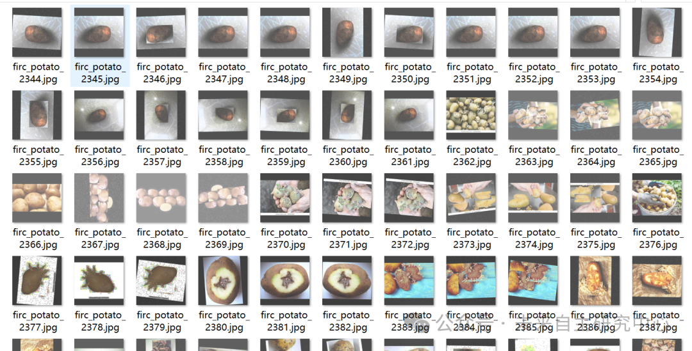
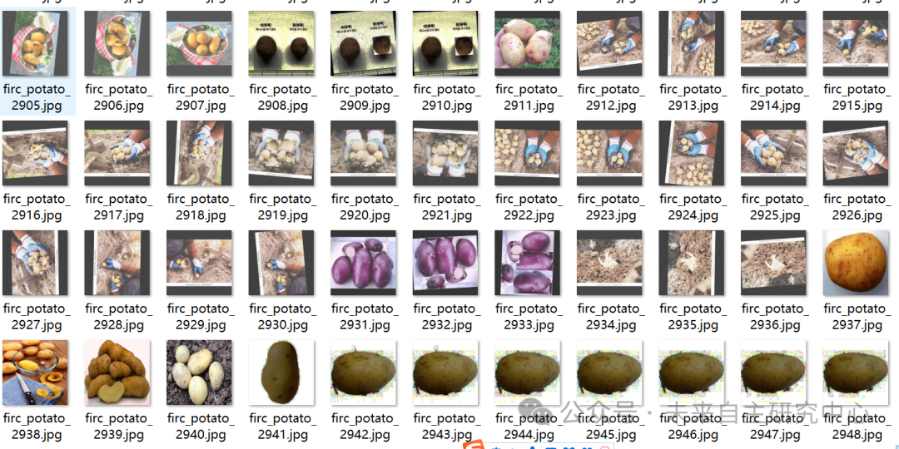
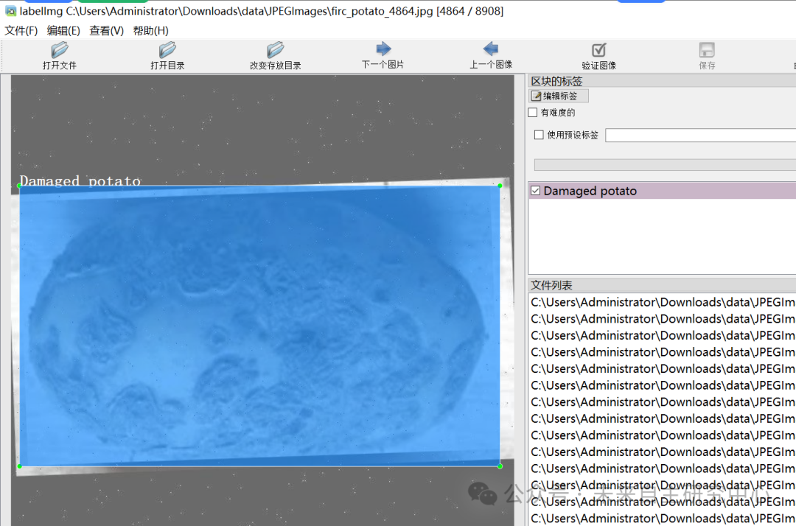

# Potato Disease Detection Dataset VOC+YOLO format with 8908 images in 5 categories

The dataset has been enhanced, please carefully review the image preview. Download only if it meets the requirements. The file is available for download through  Cloud.

Dataset format: Pascal VOC format + YOLO format (txt file without split path, only containing jpg images and corresponding VOC format xml files and yolo format txt files)

Number of images (number of jpg files): 8908

Number of annotations (number of xml files): 8908

Number of annotations (number of txt files): 8908

Label category count: 5

Label category names: ["Damaged potato", "Defective potato", "Diseased-fungal potato", "Potato", "Sprouted potato"]

Number of boxes labeled in each category:

Damaged potato frame count = 4850

Defective potato frame count = 3953

Diseased-fungal potato frame count = 7674

Potato Frames = 9868

Sprouted potato Frames = 4509

Total frame count: 30854

Using labelImg:

Annotation rules: Draw a rectangle around the category.

Important Notice: No

Special : This dataset does not guarantee the accuracy or precision of the trained models or weight files. The dataset is provided with accurate and reasonable annotations only.

Image Preview:

Annotation example:

## Payment

Here is a pay link on Stripe ( https://buy.stripe.com/3cs8yP7sY87d0vu9AB ). Please contact me lonlonago@foxmail.com after funding $89, and I will send you a complete data files , thank you!

